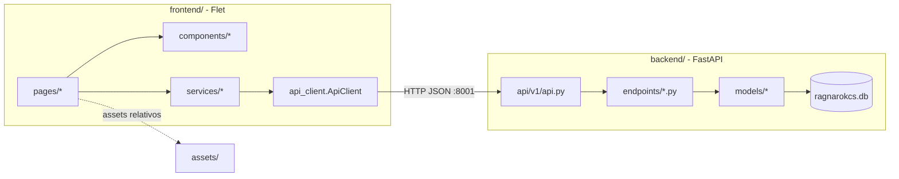

# Arquitetura geral

## Estrutura de pastas

```
ragnarok-cs/
├── backend/                 API FastAPI
│   ├── main.py              cria o app FastAPI e sobe o uvicorn na porta 8001
│   ├── seed_data.py         cria as tabelas e insere os dados do jogo (idempotente)
│   ├── create_tables.py     só cria as tabelas, sem dados
│   ├── core/                configuração, engine do banco, dependência de sessão
│   ├── models/              modelos SQLAlchemy (tabelas)
│   ├── schemas/             modelos Pydantic (formato das respostas/requisições)
│   └── api/v1/              roteadores e endpoints
├── frontend/                app Flet
│   ├── main.py              cria a janela e o roteador
│   ├── routes.py            lista de rotas (uma por tela, mais uma por mapa)
│   ├── config.py            ASSETS_DIR (pasta assets/ na raiz)
│   ├── themes.py            todas as cores da interface
│   ├── pages/               telas completas (uma por rota)
│   ├── components/          peças reutilizáveis (cards, painéis, tabuleiro…)
│   └── services/            chamadas HTTP, estado da sessão, lógica da batalha
├── assets/                  imagens, fontes, sprite sheets (servidos pelo Flet)
├── tools/                   scripts de conversão de sprites do Ragnarok Online
├── art_source/              arquivos .spr/.act originais (ignorado pelo git)
└── docs/                    esta documentação
```

## Como as partes se encaixam



- O **frontend não acessa o banco**. Tudo passa pela API.
- O **backend não conhece telas**: só devolve dados no formato que o frontend consome.
- Os **caminhos de imagem** guardados no banco (ex.: `monsters/poring.gif`) são relativos à pasta `assets/`. O Flet serve essa pasta porque `frontend/main.py` passa `assets_dir=ASSETS_DIR` para `ft.run`.

## Como rodar

As duas aplicações usam imports relativos à própria pasta (`from core.config import ...`, `from services.x import ...`), então cada uma deve ser executada **de dentro da sua pasta**.

```bash
pip install -r requirements.txt
```

```bash
cd backend && python seed_data.py
```

```bash
cd backend && python main.py
```

```bash
cd frontend && python main.py
```

**A ordem importa.** O backend precisa estar no ar antes do frontend. Na importação, `frontend/routes.py` chama `MapService.get_map_ids_sync()` para registrar uma rota `/map/<map_id>` por mapa. Se a API estiver fora do ar, essa chamada devolve `[]` sem avisar, e nenhuma tela de mapa existe.

Observações:
- `requirements.txt` está em UTF-16 (o pip lê normalmente).
- Os scripts de `tools/` precisam também de Pillow e numpy, que não estão no `requirements.txt`.
- Com o backend no ar, a documentação interativa do FastAPI fica em `http://localhost:8001/docs`.

## Configuração do backend

`backend/core/config.py` define:

- **`Settings`** (pydantic-settings, lê `.env`):
  - `DEBUG=True` faz `settings.db_url` usar `DB_URL_DEV` (`sqlite+aiosqlite:///./ragnarokcs.db`); com `DEBUG=False` usa `DB_URL_PROD`, que está vazio.
  - `API_V1_STR = "/api/v1"` é o prefixo de todas as rotas.
  - `algorith` e `acess_token_expire_minutes` existem, mas ainda não são usados (não há autenticação).
- **`DBBaseModel`**: a base declarativa de todos os modelos.

`backend/core/database.py` cria o `engine` assíncrono e a fábrica `Session`. `backend/core/deps.py` expõe `get_session()`, usada pelos endpoints com `Depends(get_session)`.

## Convenções do frontend

- **Páginas** (`pages/`) são componentes `@ft.component` que usam hooks (`ft.use_state`, `ft.use_effect`). Chamadas assíncronas rodam com `ft.context.page.run_task(...)`.
- **Componentes** (`components/`) são, em geral, funções simples que devolvem controles Flet. Alguns também são `@ft.component` porque têm estado próprio (`battle_board`, `job_sprite`).
- **Cores** ficam todas em `themes.py` (ex.: `BUTTON_PRIMARY`, `CARD_BG`, `TITLE_TEXT`). As páginas importam como `import themes as t`.
- **Fonte**: Cinzel, registrada em `frontend/main.py` a partir de `assets/fonts/Cinzel-Regular.ttf`.
- **Navegação**: `ft.context.page.navigate(rota)`. Os helpers de mapa e batalha ficam em `services/map_router_manager.py`.

## Assets

| Pasta em `assets/` | Conteúdo |
|---|---|
| `maps/` | imagens de capa dos mapas |
| `monsters/`, `npcs/`, `places/` | ícones dos cards da tela de mapa |
| `characters_badges/` | avatares redondos por job |
| `sprites/<nome>/` | sprite sheets geradas por `tools/ro_to_sheet.py` (`<nome>_sheet.png` + `<nome>.json`) |
| `skills/` | ícones das skills |
| `battle_boards/` | fundo do tabuleiro de batalha |
| `icons/` | ícones da barra lateral |
| `fonts/` | fonte Cinzel |
| raiz | `Logo_bg.png`, `background.png`, `Icon.png` |
