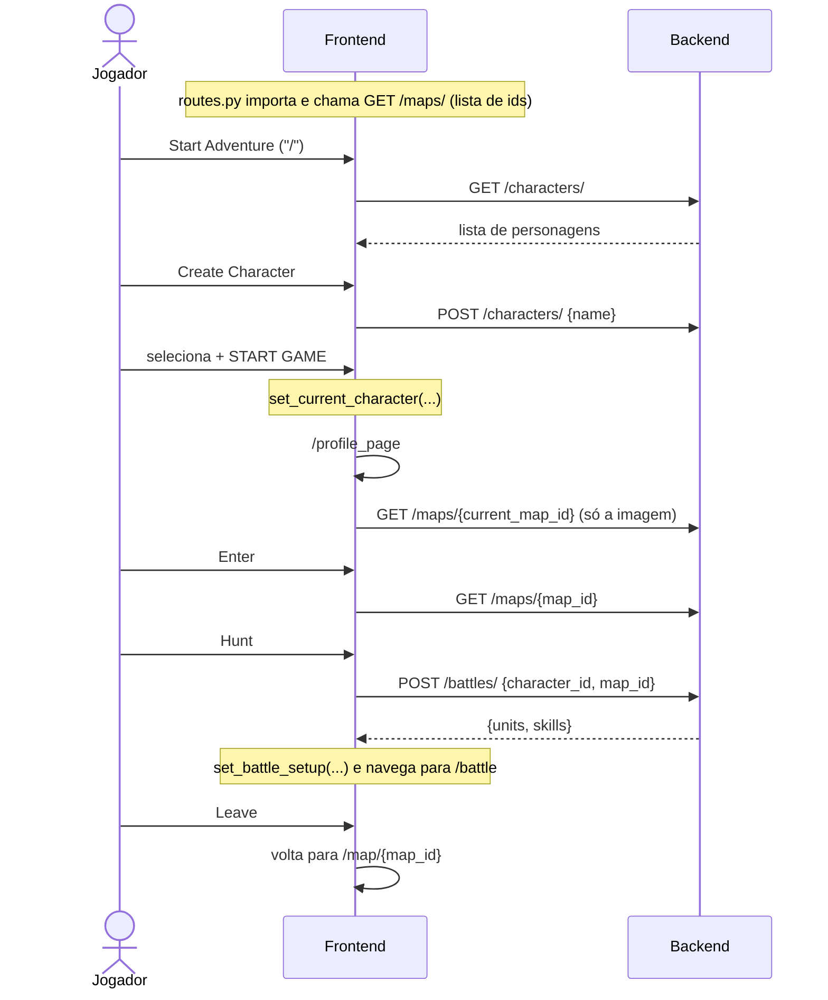

# Integração frontend/backend

O frontend conversa com o backend apenas por HTTP/JSON. Este documento mostra as camadas envolvidas, do botão na tela até o banco, e o que fica guardado no app entre telas.

## Camadas no frontend

```
pages/*.py  ──►  services/<domínio>_service.py  ──►  services/api_client.py  ──►  http://localhost:8001
(tela)            (CharacterService, MapService,       (ApiClient, ApiError)
                   BattleService)
```

### `services/api_client.py`

- `BASE_URL = "http://localhost:8001"`: endereço fixo da API.
- **`ApiClient`** encapsula um `httpx.AsyncClient`:
  - `get(path, params=None)` e `post(path, json=None)` são assíncronos e devolvem o JSON já decodificado.
  - `_handle(response)` centraliza os erros: qualquer status HTTP de erro vira uma **`ApiError(status_code, detail)`**, onde `detail` é o corpo da resposta em texto.
- **`api`** é a instância compartilhada que todos os services usam.

> Também existe uma variável `api_client = httpx.AsyncClient(...)` no mesmo arquivo que não é usada por ninguém.

### Services por domínio

| Service | Arquivo | Métodos | Endpoint |
|---|---|---|---|
| `CharacterService` | `services/character_service.py` | `get_characters()` | `GET /api/v1/characters/` |
| | | `create_character(name)` | `POST /api/v1/characters/` |
| | | `delete_character(character_id)` | `DELETE /api/v1/characters/{character_id}` |
| `MapService` | `services/map_service.py` | `get_map(map_id)` | `GET /api/v1/maps/{map_id}` |
| | | `get_map_ids_sync()` | `GET /api/v1/maps/` (síncrono, ver abaixo) |
| `BattleService` | `services/battle_service.py` | `start_battle(character_id, map_id)` | `POST /api/v1/battles/` |

`MapService.get_map_ids_sync()` é **síncrono de propósito**. Ele roda quando `routes.py` é importado, antes de o loop de eventos do Flet existir, e usa `httpx.get` direto. Em caso de erro devolve `[]` em silêncio.

`services/map_thumbnail_selector.py` (`map_thumbnail_selector(map_id)`) é um atalho que chama `MapService.get_map` e devolve só o campo `image`, usado no card "Current Place" do perfil.

### Padrão de chamada nas páginas

Todas as páginas seguem o mesmo padrão: uma função assíncrona interna, disparada com `run_task`, que trata `ApiError` com `print`.

```python
def on_mount():
    async def fetch():
        try:
            set_map_data(await MapService.get_map(map_id))
        except ApiError as e:
            print(f"Failed to load map: {e.detail}")
        finally:
            set_loading(False)

    ft.context.page.run_task(fetch)

ft.use_effect(on_mount, [])   # [] = roda uma vez, ao montar a tela
```

Hoje **nenhum erro de API aparece para o usuário**; eles só vão para o console.

## Estado da sessão (`services/session_state.py`)

É um armazenamento global em variáveis de módulo. Ele guarda o que precisa sobreviver à troca de telas:

| Função | Guarda | Quem escreve | Quem lê |
|---|---|---|---|
| `set_current_character` / `get_current_character` | o dict do personagem escolhido | `char_selection.handle_start_game` | `profile_page`, telas de mapa |
| `set_battle_return_route` / `get_battle_return_route` | rota para voltar após a batalha | `map_router_manager.navigate_to_battle` | `navigate_back_from_battle` |
| `set_battle_setup` / `get_battle_setup` | resposta de `POST /battles/` | `navigate_to_battle` | `battle_page` |

O personagem guardado é uma **cópia** do que veio da API no momento da seleção. Se o backend mudar algo, por exemplo HP ou zeny, a cópia não é atualizada.

## Fluxo de telas e chamadas



## Rotas do frontend (`frontend/routes.py`)

| Rota | Componente | Arquivo |
|---|---|---|
| `/` | `start_game` | `pages/start_game.py` |
| `/char_selection` | `character_selection` | `pages/char_selection.py` |
| `/char_creation` | `character_creation` | `pages/char_creation.py` |
| `/profile_page` | `profile_page` | `pages/profile_page.py` |
| `/battle` | `battle_page` | `pages/battle_page.py` |
| `/map/<map_id>` | `build_map_page(map_id)` | `pages/map_screen.py` (uma rota por mapa) |

`view_wrapper(component, route, appbar_visible)` envolve cada página num `ft.View`. Só a tela de criação de personagem mostra a AppBar.

## Contrato de dados

O formato de cada resposta está em [Endpoints do backend](endpoints-backend.md). Dois pontos sensíveis:

- **`GET /maps/{id}`**: `to_response()` em `backend/api/v1/endpoints/maps.py` "achata" as relações do ORM (NPCs, spawns, conexões) no formato que `map_screen.py` lê. Se os modelos mudarem, mantenha esse formato estável.
- **`POST /battles/`**: as unidades **não vêm com posição**. O frontend adiciona `col`, `row` e `facing` em `spawn_units` (`services/battle_state.py`). Os campos estão descritos em [Sistema de combate](sistema-de-combate.md).

## Pontos de atenção

- **URL fixa**: `BASE_URL` está escrita no código. Para apontar para outro servidor é preciso editar `api_client.py`.
- **Sem autenticação**: qualquer cliente pode listar e criar personagens.
- **Dependência na inicialização**: sem backend no ar, o app abre, mas sem rotas de mapa (ver [Arquitetura](arquitetura.md#como-rodar)).
- **Erros silenciosos**: `ApiError` só é impresso no console.
