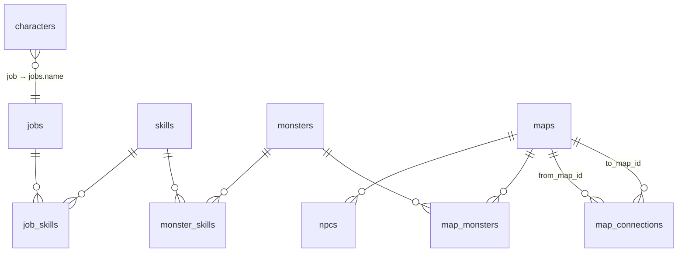

# Modelo de dados

O banco é um SQLite (`backend/ragnarokcs.db`, ignorado pelo git) acessado com SQLAlchemy assíncrono (`aiosqlite`). Todos os modelos herdam de `DBBaseModel` (`backend/core/config.py`) e ficam em `backend/models/`.

## Diagrama



## Tabelas

### `characters`: `CharacterModel` (`models/character_model.py`)

| Coluna | Tipo | Padrão | Observação |
|---|---|---|---|
| `id` | Integer PK | autoincremento | |
| `name` | String(255) | n/a | obrigatório |
| `job` | String(255), FK `jobs.name` | `"Novice"` | |
| `level` | Integer | 1 | |
| `exp` | Integer | 0 | |
| `hp` / `max_hp` | Integer | 50 / 50 | HP do herói na batalha |
| `max_sp` | Integer | 10 | ainda não usado no jogo |
| `zeny` | Numeric(10, 2) | 0.00 | |
| `current_map` | String | `"Novice Academy"` | nome do mapa (texto duplicado) |
| `current_map_id` | String | `"novice_academy"` | id do mapa; não é FK |

### `jobs`: `JobModel` (`models/jobs_model.py`)

Dados de batalha comuns a todos os personagens de um job.

| Coluna | Tipo | Observação |
|---|---|---|
| `name` | String PK | ex.: `"Novice"`; é o valor de `characters.job` |
| `sheet` | String | pasta em `assets/sprites/<sheet>/` |
| `avatar` | String | imagem do card da unidade na batalha |
| `max_ap` | Integer | pontos de ação por turno |
| `offset_x`, `offset_y` | Integer | ajuste fino da posição do sprite no tile |

Relação: `skill_links` → `JobSkillModel`, ordenado por `slot`.

### `skills`: `SkillModel` (`models/skills_model.py`)

| Coluna | Tipo | Observação |
|---|---|---|
| `id` | Integer PK | |
| `name` | String, único | chave usada no frontend (`state.skills[name]`) |
| `ap_cost` | Integer | custo em AP |
| `damage` | Integer | dano fixo |
| `range` | Integer | alcance em tiles (linha reta) |
| `icon` | String | ícone em `assets/` |

### `job_skills`: `JobSkillModel` / `monster_skills`: `MonsterSkillModel`

Tabelas de ligação N:N com uma coluna `slot` para a ordem:

- `job_skills(job_name, skill_id, slot)`: `slot` é a ordem na barra de skills do jogador.
- `monster_skills(monster_id, skill_id, slot)`: `slot` 0 é a skill principal da IA (`battle_ai._main_skill` usa `unit["skills"][0]`).

Ambas têm `skill = relationship("SkillModel", lazy="selectin")`.

### `monsters`: `MonsterModel` (`models/monsters_model.py`)

| Coluna | Tipo | Padrão | Observação |
|---|---|---|---|
| `id` | Integer PK | | |
| `name` | String(255), único | | |
| `image` | String | | ícone (usado no mapa e como avatar na batalha) |
| `sheet` | String, **nullable** | `NULL` | **sem sheet = não pode ser caçado** |
| `max_hp` | Integer | 50 | |
| `max_ap` | Integer | 2 | |
| `ai` | String(50) | `"passive"` | nome de um comportamento em `battle_ai.BEHAVIORS` |
| `offset_x`, `offset_y` | Integer | 0 | |

Relação: `skill_links` → `MonsterSkillModel`, ordenado por `slot`.

### `maps`: `MapModel` (`models/maps_model.py`)

| Coluna | Tipo | Observação |
|---|---|---|
| `id` | String PK | ex.: `"training_field_1"`; vira a rota `/map/training_field_1` |
| `name` | String(255) | |
| `level_range` | String(30) | texto livre, ex.: `"1 - 10"` |
| `image` | String | capa do mapa |
| `about` | Text | descrição, ainda não exibida |

Relações (todas `lazy="selectin"`): `npcs`, `monster_spawns`, `connections`.

### `npcs`: `NpcModel` (`models/npcs_model.py`)

`id`, `map_id` (FK `maps.id`), `name`, `image`. Cada NPC pertence a um único mapa.

### `map_monsters`: `MapMonsterModel` (`models/map_monster_model.py`)

Liga monstros a mapas: `map_id` + `monster_id` (PK composta) e `spawn_rate`, o peso do sorteio do monstro em `POST /battles/`. Relação `monster` → `MonsterModel`.

### `map_connections`: `MapConnectionModel` (`models/map_connection_model.py`)

Arestas **direcionais** do grafo de navegação: `from_map_id` → `to_map_id`. Para ir e voltar entre dois mapas são precisas duas linhas. Relação `to_map` → `MapModel`.

## Registro dos modelos

`backend/models/__all_models.py` importa **todos** os modelos. Isso é necessário para que `DBBaseModel.metadata.create_all` conheça todas as tabelas. `main.py`, `create_tables.py` e `seed_data.py` importam esse arquivo. **Ao criar um modelo novo, adicione o import lá.**

## Dados do jogo: `backend/seed_data.py`

Não existe painel de administração: os dados do jogo são declarados em dicionários Python e gravados por `seed()`.

| Dicionário | Conteúdo atual |
|---|---|
| `SKILLS` | `Basic Attack` (1 AP, 10 de dano, alcance 1) |
| `JOBS` | `Novice` (sheet `novice`, 5 AP, skill `Basic Attack`) |
| `MONSTERS` | `Poring` (com dados de batalha, IA `approach_and_attack`); `Lunatic` e `Wilow` (só imagem) |
| `MAPS` | `novice_academy` (2 NPCs, sem monstros) e `training_field_1` (1 NPC, 3 monstros); um conectado ao outro |

Ordem de execução de `seed()`:

1. Cria as tabelas que não existem (`create_all`).
2. **Skills**: cria ou atualiza por nome (upsert).
3. **Jobs**: cria ou atualiza; apaga e regrava os vínculos em `job_skills`.
4. **Monstros**: cria ou atualiza por nome; apaga e regrava os vínculos em `monster_skills`.
5. **Mapas**: se o mapa **já existe**, só atualiza nome, faixa de nível, imagem e descrição. NPCs e spawns **não** são reinseridos nem atualizados. Se não existe, cria com NPCs e spawns.
6. **Conexões**: cria as que ainda não existem.

O script é **idempotente**: pode rodar várias vezes sem duplicar dados.

`upsert(instance, values)` é o helper que copia os campos de um dict para a instância.

### Como adicionar conteúdo

- **Monstro caçável novo**: gere a sprite sheet (ver [Sprites e animação](sprites-e-animacao.md)); adicione a entrada em `MONSTERS` com `image`, `sheet`, `max_hp`, `max_ap`, `ai`, `skills`; inclua `("Nome", peso)` na lista `monsters` do mapa.
- **Skill nova**: adicione em `SKILLS` e referencie pelo nome em `JOBS[...]["skills"]` ou `MONSTERS[...]["skills"]`.
- **Mapa novo**: adicione em `MAPS` com `navigation` nos dois sentidos e coloque a imagem em `assets/maps/`. Reinicie o frontend para registrar a rota nova.

> Limitação: como mapas existentes são pulados, **mudar NPCs ou spawns de um mapa que já está no banco não tem efeito** ao rodar o seed de novo. Nesse caso é preciso apagar o banco e recriar.

## Mudanças de schema

Não há migrações (Alembic ou similar). `create_all` cria tabelas novas, mas **não altera tabelas existentes** (colunas novas não aparecem). O caminho documentado é:

```bash
cd backend && rm ragnarokcs.db && python seed_data.py
```

Isso apaga também os personagens criados. Para preservá-los, a alternativa é aplicar `ALTER TABLE ... ADD COLUMN` manualmente antes de rodar o seed.
