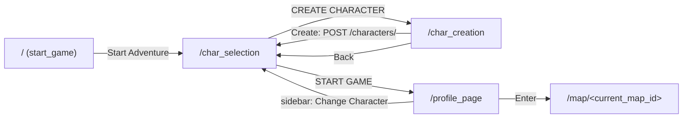

# Criação e seleção de personagens

Este documento cobre o caminho do jogador desde a tela inicial até o perfil do personagem: criar, listar, escolher e exibir.

## Visão geral do fluxo

## Tela inicial: `pages/start_game.py`

`start_game()` mostra o logo (`Logo_bg.png`) com uma animação de entrada: um `use_effect` espera 0,1 s e troca `visible` para `True`, o que dispara `animate_opacity` e `animate_scale`. O botão **Start Adventure** navega para `/char_selection`. Esta tela não faz chamadas à API.

## Criação: `pages/char_creation.py`

Componente `character_creation()`.

**O que a tela mostra**
- Uma prévia do personagem com `job_sprite("Novice", height=133)`, sempre o Novice, porque todo personagem novo nasce com esse job.
- Um campo de nome (`ft.TextField`) ligado ao estado `name_value` via `on_change`.
- Botões **Create** e **Back**.

**O que acontece ao clicar em Create** (`handle_create`)
1. Se o nome estiver vazio ou só com espaços, nada acontece (sem mensagem).
2. Chama `CharacterService.create_character(name_value)` → `POST /api/v1/characters/` com `{"name": ...}`.
3. Sucesso: volta para `/char_selection`, que recarrega a lista.
4. `ApiError`: só imprime no console.

**No backend**, `post_character` (`backend/api/v1/endpoints/characters.py`) cria um `CharacterModel` só com o nome. Os demais campos usam os padrões do modelo:

| Campo | Valor inicial |
|---|---|
| `job` | `Novice` |
| `level` / `exp` | 1 / 0 |
| `hp` / `max_hp` | 50 / 50 |
| `max_sp` | 10 |
| `zeny` | 0.00 |
| `current_map` / `current_map_id` | `Novice Academy` / `novice_academy` |

O job precisa existir na tabela `jobs` (FK `characters.job → jobs.name`), e o Novice é criado pelo `seed_data.py`. O SQLite não verifica chaves estrangeiras por padrão, mas `POST /battles/` devolve 404 se o job não existir.

## Seleção: `pages/char_selection.py`

Componente `character_selection()`.

**Carregamento**: ao montar, `fetch()` chama `CharacterService.get_characters()` → `GET /api/v1/characters/` e guarda a lista no estado `characters`.

**Layout**
- Uma grade de **6 slots** (`SLOT_COUNT`, 2 linhas × 3 colunas). `slots = characters + [None] * (SLOT_COUNT - len(characters))` completa os vazios.
- `character_slot(character, on_click, is_selected)` desenha cada slot: sprite (`job_sprite`), nome, job e level, ou "Empty". O slot selecionado tem borda dourada (`CARD_BORDER_SELECTED`).
- `info_panel(character)` mostra o HP do personagem selecionado.
- Botões:
  - **CREATE CHARACTER** → `/char_creation`.
  - **DELETE CHARACTER**: **sem ação** (não há handler nem endpoint de exclusão).
  - **START GAME** → `handle_start_game(e, slots[selected])`.

**`handle_start_game`**: se o slot estiver vazio, não faz nada. Caso contrário, chama `set_current_character(character)` (`services/session_state.py`) e navega para `/profile_page`.

> Se houver mais de 6 personagens no banco, os extras não aparecem e a lista de slots fica maior que a grade.

## Perfil: `pages/profile_page.py`

Componente `profile_page()`. Lê o personagem com `get_current_character()`. Se não houver um, mostra "No character selected" e um botão para voltar à seleção.

**Blocos da tela**
- `sidebar(...)` (`components/sidebar.py`), recolhida por padrão.
- `zeny_badge(character["zeny"])` no topo.
- `character_card(character)`: sprite grande (`job_sprite(..., height=190)`), nome, job, level e as barras de HP e EXP (`components/status_bars.status_bar`). O máximo de EXP é a constante `MAX_EXP_DEFAULT = 100`, marcada como TODO até existir uma tabela de progressão.
- `current_place_card(character, thumbnail)`: imagem e nome do mapa atual e o botão **Enter**, que chama `navigate_to_map(character["current_map_id"])`. A miniatura vem de `map_thumbnail_selector`, que faz `GET /maps/{id}` só para pegar a `image`.
- `info_panel("ATTRIBUTES")`, `info_panel("STATUS")` e `skills_panel()`: **placeholders**, só exibem o título.

## Barra lateral: `components/sidebar.py`

`sidebar(collapsed, on_toggle)` aparece no perfil, nos mapas e na batalha. Largura de 72 px recolhida e 240 px aberta, com animação. Itens com ação:
- **Profile** → `/profile_page`
- **Change Character** → `/char_selection`

Os itens Quests, Inventory, World Map, Instances e Wiki ainda **não fazem nada**.

## Aparência do personagem

Três funções de `services/sprite_selector.py` decidem a imagem por job **no frontend**:

| Função | Mapa | Usado em |
|---|---|---|
| `sheet_selector(job)` | `JOBS_SHEETS` (`"Novice" → "novice"`) | `components/job_sprite.py` |
| `sprite_selector(job)` | `JOBS_SPRITES` (vazio) | GIF de reserva para jobs sem sheet |
| `badge_selector(job)` | `JOBS_BADGES` | `components/character_badge.py` (avatar no topo dos mapas) |

`job_sprite(job, height)` é um componente com animação própria. Ele usa o clip `stand_s` da sheet, a pose parada e de frente com a cabeça virando (ver [Sprites e animação](sprites-e-animacao.md)). Um loop assíncrono avança o frame a cada `1 / clip.fps` segundos e para quando o componente é desmontado (`loop_state["closed"]`).

> Essas tabelas repetem dados que já existem em `JobModel` no backend (`sheet`, `avatar`). Hoje a batalha usa os dados do backend, e as telas de personagem usam os do frontend.

## O que ainda não existe

- Excluir personagem (botão sem ação; sem `DELETE /characters/{id}`).
- Escolher job na criação (sempre Novice) e trocar de job.
- Validação de nome no backend (vazio, tamanho, duplicado).
- Atributos (STR, AGI…), SP em uso, progressão de nível e EXP.
- Persistir mudanças: nenhuma rota altera um personagem depois de criado, então mapa atual, HP, EXP e zeny nunca mudam.
- Atualizar o personagem guardado em `session_state` (é uma cópia tirada na seleção).
- Mostrar erros da API para o jogador.
