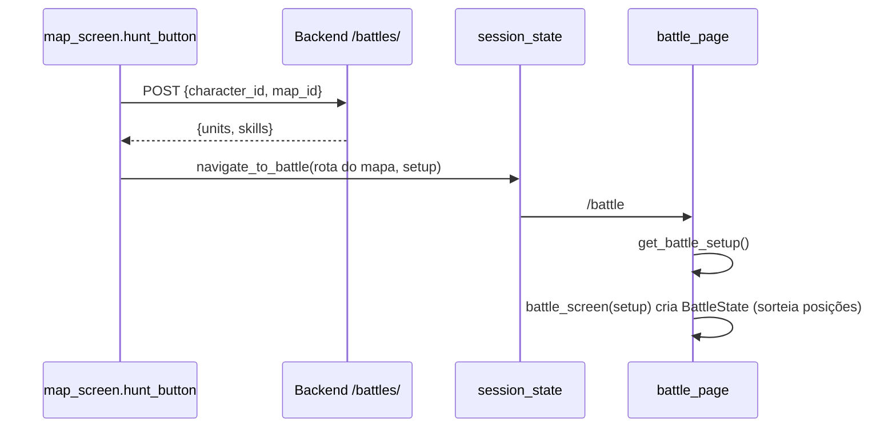

# Sistema de combate

O combate é **por turnos, num tabuleiro isométrico 10×10**. O backend só **monta o encontro** (quem luta e com quais skills); toda a regra do jogo roda no frontend, dentro de `frontend/services/battle_*.py`, e a tela fica em `frontend/pages/battle_page.py`.

## Do botão Hunt até a tela



- `battle_page()` lê `get_battle_setup()`. Sem setup (rota aberta direto), mostra "No battle in progress".
- `battle_screen(setup)` cria o estado com `ft.use_state(lambda: BattleState(...))`. A **lambda** garante que o estado, e o sorteio de posições, só seja criado no primeiro render, e não a cada re-render.

## A unidade (dict)

Cada unidade é um **dict simples**, mutado diretamente. Campos:

| Campo | Origem | Uso |
|---|---|---|
| `name`, `job`, `team` (`"player"`/`"enemy"`) | backend | identidade; `team` define aliados e inimigos |
| `sheet`, `avatar`, `offset_x`, `offset_y` | backend | desenho (sprite sheet, card, ajuste no tile) |
| `hp`, `max_hp`, `ap`, `max_ap` | backend | vida e pontos de ação |
| `skills` | backend | nomes das skills; a primeira é a principal da IA |
| `ai` | backend | comportamento do inimigo (`None` no herói) |
| `col`, `row` | `spawn_units` | posição no tabuleiro |
| `facing` (`se`/`sw`/`nw`/`ne`) | `spawn_units`, ações | direção do sprite |
| `anim`, `anim_started` | `battle_animation.play` | clip atual e quando começou |
| `walk_path` | `battle_animation.start_walk` | tiles da última caminhada (partida → destino), usados para desenhar a unidade andando |

As unidades ficam em `state.units`, com as chaves `"hero"` e `"monster_1"`, `"monster_2"`… (um por monstro da caçada, na ordem em que foram sorteados). `components/skills_panel.py` lê as skills de `state.units["hero"]`, então a chave `hero` é obrigatória.

## Estado da batalha: `services/battle_state.py`

### Posições iniciais

`place_unit(unit, taken, board)` escolhe o tile do herói em `BattleState.__init__` e o de cada monstro em `spawn_monsters`:

| Time | Colunas possíveis (`SPAWN_COLUMNS`) | Linha | Direção inicial (`SPAWN_FACING`) |
|---|---|---|---|
| `player` | 0 | aleatória (0–9) | `se` (olhando para os inimigos) |
| `enemy` | 7, 8 ou 9 | aleatória (0–9) | `nw` |

O sorteio usa `random.choice` sobre os tiles livres. Ele evita `board.blocked_tiles` e os tiles já ocupados, então duas unidades nunca nascem no mesmo lugar.

### `BattleState`

```python
BattleState(units: dict, skills: dict, board: BoardConfig, monsters: list | None = None,
            turn_duration: int = 30)
```

### Os monstros da caçada

A caçada **não é infinita**: ela começa com uma quantidade aleatória de **3 a 6 monstros** (`MIN_MONSTERS` e `MAX_MONSTERS`, `backend/core/battle_rules.py`) e termina quando o herói mata todos (**vitória**) ou morre (**derrota**).

- O **backend** sorteia os monstros em `POST /api/v1/battles/` (`random.choices`, usando o `spawn_rate` de cada monstro no mapa como peso; o mesmo monstro pode se repetir) e devolve a lista pronta em `monsters`. Não há mais `spawn_pool` nem novos monstros no meio da luta.
- `BattleState.spawn_monsters(monsters)` coloca cada monstro num tile livre das colunas 7–9 (`place_unit`), com os ids `monster_1`, `monster_2`… na ordem recebida.
- `begin_round()` só remove do tabuleiro os monstros mortos a cada nova rodada, para a lista de unidades não encher; os números da tela de resultado ficam em `monster_damage`, que não depende disso.

| Atributo | Significado |
|---|---|
| `units` | cópia profunda (`copy.deepcopy`) das unidades recebidas |
| `skills` | definição das skills (`{nome: {ap_cost, damage, range, icon}}`) |
| `board` | `BoardConfig` |
| `turn_order` | o herói primeiro, depois os monstros na ordem em que nasceram, ex.: `["hero", "monster_1", "monster_2"]`: **o herói sempre começa** |
| `turn_index`, `round` | de quem é a vez e a rodada atual (começa em 1) |
| `turn_duration`, `time_left` | limite de 30 s por turno (`TURN_DURATION`) |
| `winner` | `None`, `"victory"` (todos os monstros mortos) ou `"defeat"` (o herói morreu) |
| `kills`, `exp_pending` | nomes dos monstros que o herói matou e a EXP deles (mostrada no log; só é paga se o herói vencer) |
| `monster_damage`, `damage_taken` | dano causado a cada monstro e dano recebido pelo herói (tela de resultado) |
| `finishing` | `True` quando o fim da batalha já está sendo processado |
| `log` | `BattleLog` |
| `input_locked` | `True` durante o turno do inimigo |
| `closed` | `True` quando a tela sai; para os loops |
| `version` | contador usado para forçar re-render |

Métodos:
- `current_unit_id` / `current_unit()`: de quem é a vez.
- `is_alive(unit_id)`, `unit_at(col, row)` (só unidades vivas).
- `refill_ap(unit_id)`: AP volta ao máximo.
- `end_turn()`: avança para a próxima unidade **viva**; ao dar a volta na lista, incrementa `round` e chama `begin_round()`; reinicia o relógio e recarrega o AP de quem vai jogar.
- `tick()`: chamado a cada segundo; desconta `time_left` e, se zerar, chama `end_turn()` e devolve `True`.
- `check_battle_end()`: sem jogador vivo → `defeat`. Registra uma entrada `end` no log.

## Ações: `services/battle_actions.py`

Todas as ações seguem o par **validar → executar** e devolvem um dict `{"ok": bool, "reason": str, ...}`.

### Movimento

`can_move(state, unit_id, col, row) -> (ok, reason, custo)` recusa se:
- a batalha acabou ou não é a vez da unidade;
- o destino é o tile atual, está fora do tabuleiro, bloqueado ou ocupado;
- não existe caminho até o destino;
- o custo for maior que o AP disponível.

O **custo é o tamanho do caminho mais curto** (`find_path`): 1 AP por tile. `find_path` faz uma busca em largura (BFS) em 4 direções (só linhas e colunas, sem diagonal), desviando de `board.blocked_tiles` e de unidades vivas. Devolve a lista de tiles sem o de partida, ou `None` se não há caminho.

`perform_move` chama `start_walk` (`services/battle_animation.py`), desconta o AP e registra um `LogEntry(kind="move")`. `start_walk` já coloca `col`/`row` no destino (ocupação e alcance passam a valer na hora), guarda o caminho em `walk_path`, vira a unidade para a direção do último passo e toca o clip `walk`. Enquanto o clip toca, `walk_pose`/`board_position` interpolam a posição desenhada tile a tile (`WALK_SECONDS_PER_TILE = 0.35`), virando o sprite a cada trecho. Ao chegar, `current_frame` volta para `idle`. O jogador só age de novo, e a IA só faz a próxima ação, quando `walk_remaining` chega a 0.

### Ataque

`can_attack(state, attacker_id, target_id, skill_name)` exige:
- batalha em andamento e vez do atacante;
- a skill existir em `state.skills` **e** estar na lista `skills` do atacante;
- alvo vivo e do outro time;
- AP suficiente (`ap_cost`);
- alvo **em linha reta**, na mesma linha ou coluna, a uma distância entre 1 e `range` (`in_range`). Diagonais não contam.

`perform_attack`:
1. Desconta `ap_cost` e aplica `damage` (fixo, sem defesa ou variação; o HP não fica negativo).
2. Vira o atacante para o alvo e toca `attack`. O alvo toca `hurt`, ou `dead` se o HP zerar.
3. Cria o número de dano flutuante (`damage_popup`, em `state.damage_popups`) e registra `LogEntry(kind="attack")`, que aparece no Battle Log como "X uses Skill in Y: **-N damage**", com o dano em vermelho (`DAMAGE_TEXT`). Vale para o herói e para os monstros.
4. Se o alvo morreu, registra `LogEntry(kind="defeat")` e chama `state.check_battle_end()`.

### Números de dano (`services/battle_animation.py`)

Cada golpe gera um número que **salta** da cabeça do alvo: sobe até `POPUP_JUMP_HEIGHT` (34 px) em 40% do tempo, desce um pouco, desliza `POPUP_DRIFT_X` para o lado e some no fim de `POPUP_DURATION` (1,1 s). Ele aparece `POPUP_DELAY` (0,25 s) depois do início do ataque, mais ou menos quando o golpe acerta.

- `damage_popup(target, amount, from_player)` guarda o tile e a altura da cabeça do alvo (`head_height`, pelo `box` do clip `idle`), porque monstros mortos saem da batalha na rodada seguinte.
- `popup_pose(popup)` é uma função pura do tempo: devolve `(dx, dy, opacidade)` ou `None` fora da janela. `perform_attack` descarta os números expirados (`popup_alive`).
- Cor: **branco** (`DAMAGE_POPUP_BY_PLAYER`) quando o herói causa o dano, **vermelho** (`DAMAGE_POPUP_BY_ENEMY`) quando um monstro acerta o herói. Fonte Cinzel, com sombra preta (`DAMAGE_POPUP_OUTLINE`) para ler sobre o tabuleiro.

`get_attack_tiles(state, unit_id, skill_name)` devolve os tiles que a skill alcança nas 4 direções, usados para destacá-los no tabuleiro.

## IA dos inimigos: `services/battle_ai.py`

`iter_ai_turn(state, unit_id)` escolhe o comportamento em `BEHAVIORS` pelo campo `unit["ai"]` (padrão `passive`). Cada comportamento é um **gerador**: dá `yield` depois de cada ação para a página redesenhar e esperar entre os passos.

| Nome | Função | Comportamento |
|---|---|---|
| `passive` | `passive` | não faz nada |
| `attack_every_turn` | `attack_every_turn` | não se move; ataca o inimigo mais próximo enquanto conseguir (AP, alcance) |
| `approach_and_attack` | `approach_and_attack` | se não alcança o alvo, anda até o melhor tile e então ataca enquanto der. **É o do Poring.** |

Funções auxiliares:
- `_main_skill(unit)`: `unit["skills"][0]`.
- `_nearest_enemy_id`: inimigo vivo mais próximo pela distância de Manhattan.
- `_best_approach_tile`: testa todos os tiles válidos e escolhe pela ordem de prioridade (1) poder atacar dali com o AP que sobra, (2) menor distância ao alvo, (3) menor custo. Se nenhum tile melhora a situação, fica parado.

`run_ai_turn` executa o gerador inteiro sem pausas (útil em testes).

## Tela de batalha: `pages/battle_page.py`

### Loops

Ao montar, `battle_screen` inicia duas tarefas assíncronas:

- **`turn_loop`**
  - Turno do **inimigo**: trava a entrada (`input_locked = True`), espera `ENEMY_ACTION_DELAY` (0,7 s), percorre `iter_ai_turn` com uma pausa após cada ação, chama `end_turn()` e destrava.
  - Turno do **jogador**: acorda a cada `TICK_INTERVAL` (0,25 s) e chama `state.tick()` a cada 1 s acumulado. Se o tempo acabar, o turno passa sozinho e a skill selecionada é limpa.
  - Para quando a batalha acaba ou a tela fecha.
- **`anim_loop`**: re-renderiza a ~12 fps (`ANIM_INTERVAL = 1/12`) para as animações andarem. Ele **não para quando há vencedor**, para que o clip `dead` termine de tocar; só para com `state.closed`.

`on_unmount` e o botão **Leave** marcam `state.closed = True`. Quando aparece um vencedor, o `anim_loop` dispara `finish_battle` (uma única vez, `state.finishing`): ver [Fim da batalha](#fim-da-batalha).

`refresh(clear_skill=False)` deve ser chamado depois de **qualquer** mudança no estado: incrementa `state.version` e atualiza um `use_state`, o que força o re-render.

### Interação do jogador

| Ação | Onde | Como |
|---|---|---|
| Mover | `components/battle_board.py` | sem skill selecionada, clicar num tile (`handle_tap` → `perform_move`): a unidade anda até lá pelo caminho mais curto. Com o mouse sobre um tile (`on_hover`), o caminho fica verde (`VALID_TILE_COLOR`) se `can_move` aceitar; senão, o tile fica vermelho. |
| Escolher skill | `components/skills_panel.py` → `handle_select_skill` | clique no ícone, ou o atalho **Q/W/E/R/T** (1ª a 5ª skill do herói, `SKILL_KEYS` em `skills_panel.py`); repetir desmarca. Só funciona na vez do jogador e com AP suficiente. O atalho aparece no canto do ícone. |
| Atalhos de teclado | `pages/battle_page.py` → `handle_key` | `page.on_keyboard_event`, religado a cada render (para ver a skill selecionada) e removido ao sair da tela. Ignora combinações com Shift, Ctrl, Alt ou Meta. **Espaço** aciona o Turn End (`handle_end_turn`). Fora isso, só seleciona skills. |
| Atacar | `battle_board.handle_tap` | com uma skill selecionada, os tiles de alcance ficam destacados (`ATTACK_TILE_COLOR`); clicar no sprite de um inimigo chama `perform_attack`. |
| Passar a vez | `components/turn_panel.py` → `handle_end_turn` | botão **Turn End** |
| Sair | `turn_panel` → `handle_leave` | botão **Leave**, sempre habilitado; volta para o mapa com `navigate_back_from_battle()`, **sem custo e sem EXP** (nada é enviado ao backend) |

O tile sob o mouse fica num dict global do módulo, `_hover_state`, em `battle_board.py`.

### Layout

```
┌ sidebar ┬─────────────────────────────────────────────────────────┐
│         │ units_panel (330)  │ battle_board (1100 × 700)          │
│         │────────────────────┼──────────────────┬─────────────────│
│         │ skills_panel (330) │ battle_log_panel │ turn_panel (300)│
└─────────┴─────────────────────────────────────────────────────────┘
```

- `units_panel` (`components/unit_card.py`): um card por unidade, na ordem dos turnos, com avatar, nome, job, barra de HP vermelha (`HP_BAR_COLOR`, diminui conforme a unidade perde vida), HP e AP. A unidade da vez tem borda dourada; mortas ficam com 40% de opacidade.
- `battle_log_panel` (`components/battle_log_panel.py`): mostra `state.log.entries` com rolagem automática.
- `turn_panel`: rodada, tempo restante, "Enemy turn...", "Victory!" ou "Defeat...", e os botões.
- `CONTENT_WIDTH = LEFT_WIDTH + GAP + BOARD_WIDTH` (1446 px) também limita a largura das telas de mapa.

### Desenho do tabuleiro (`components/battle_board.py`)

Quatro camadas num `ft.Stack`, dentro de um `ft.GestureDetector`:

1. **Fundo**: `board.background_image` (`battle_boards/forest_battlefield.jpg`) ou uma cor de reserva.
2. **Grade**: `cv.Canvas` com `STATIC_GRID_SHAPES` (montados uma vez na importação, em `components/battle_grid.py`: todos os tiles com a mesma cor, no tom do terreno do fundo (`TILE_COLOR`, translúcida), e os contornos por cima) mais os destaques do momento.
3. **Sprites**: unidades ordenadas por profundidade (`sort_units_by_depth`). Unidades mortas continuam desenhadas para mostrar o último frame de `dead`. A posição e a profundidade usam `board_position`, então quem está andando aparece entre os tiles.
4. **Números de dano**: `damage_popup_control` para cada item de `state.damage_popups`, por cima de todos os sprites. Como a página só re-renderiza ~12 vezes por segundo, cada número usa `animate_position`/`animate_opacity` (`POPUP_FRAME_MS`) com uma `key` própria, e o Flutter suaviza o movimento entre um quadro e outro.

> Existe um ramo para unidades **sem** sprite sheet que usa os campos `sprite`, `width`, `height` e `placeholder_color`. O backend não envia esses campos; o ramo sobrou da época do mockup e só não quebra porque toda unidade enviada hoje tem `sheet`.

## Geometria: `services/battle_geometry.py`

`BoardConfig`: palco fixo de 1100×700, grade 10×10, tiles de 96×48 (losango 2:1), origem do tile (0,0) em (540, 200), `blocked_tiles` vazio, `show_grid=True`.

| Função | Faz |
|---|---|
| `tile_to_pixel(col, row, board)` | centro do tile em pixels. +1 col anda para baixo-direita; +1 row anda para baixo-esquerda |
| `pixel_to_tile(x, y, board)` | inversa, com `round()`; é o que dá o "encaixe" ao soltar o sprite |
| `is_inside_board` | limites da grade |
| `get_depth(unit)` | `col + row`; maior = mais perto da câmera |
| `sort_units_by_depth(units, farthest_first)` | ordem de pintura (`True`) ou de clique (`False`) |
| `get_sprite_bounds(unit, cx, cy)` | caixa do sprite com os **pés** (anchor da sheet) no centro do tile, mais `offset_x/offset_y` |

Direções no tabuleiro: +col = SE, -col = NW, +row = SW, -row = NE (`battle_animation.face_towards`).

## Log: `services/battle_log.py`

`LogEntry` (dataclass) tem `round`, `kind` (`move`, `attack`, `defeat`, `exp`, `exp_loss`, `level_up`, `end`) e os campos opcionais `actor`, `target`, `skill`, `damage`, `tiles`, `dest`, `exp`, `level` e `result`. A propriedade `message` gera o texto, `damage_text` gera o "-N damage" (vermelho) e `level_text` gera o "Level N" da subida de nível (dourado). `BattleLog` é só uma lista com `add()` e `print_all()`.

## Fim da batalha

- **Vitória**: todos os monstros mortos (`check_battle_end` marca `winner = "victory"`). **Derrota**: o herói com HP 0 (`winner = "defeat"`).
- O painel de turno mostra "Victory!" ou "Defeat..." e a entrada final entra no log. Depois de `END_DELAY` (2 s, para a animação de morte terminar) o `anim_loop` chama `finish_battle`, que **sai sozinho da batalha**:
  1. envia o resultado ao backend (`POST /api/v1/characters/{id}/battle-result`, ver [Regra de experiência](regra-de-experiencia.md)): na vitória, os nomes dos monstros mortos; na derrota, só o aviso. O backend paga ou tira a EXP e devolve o personagem;
  2. guarda o relatório em `session_state` (`set_battle_result`);
  3. volta para o mapa (`navigate_back_from_battle`).
- **Tela de resultado**: o mapa abre um pop up (`components/battle_result_dialog.py`, lido uma única vez por `pop_battle_result` em `map_screen`) com o título **"Victory!"** em amarelo (`VICTORY_TEXT`, o dourado do jogo) ou **"Defeat"** em vermelho (`DEFEAT_TEXT`), o **dano total causado**, o **dano causado a cada monstro** (monstros repetidos viram "Poring 1", "Poring 2"…), o **dano recebido** e a EXP (ganha e o novo nível na vitória; perdida na derrota).
- O dano contado é o HP que realmente saiu: um golpe de 10 num monstro com 4 de HP conta 4.
- **Leave** (botão) encerra sem resultado: não perde EXP, não ganha EXP dos monstros que já matou e não abre o pop up.
- O HP do personagem e o zeny não mudam; só EXP e nível são gravados, e só ao fim de uma vitória ou derrota.
