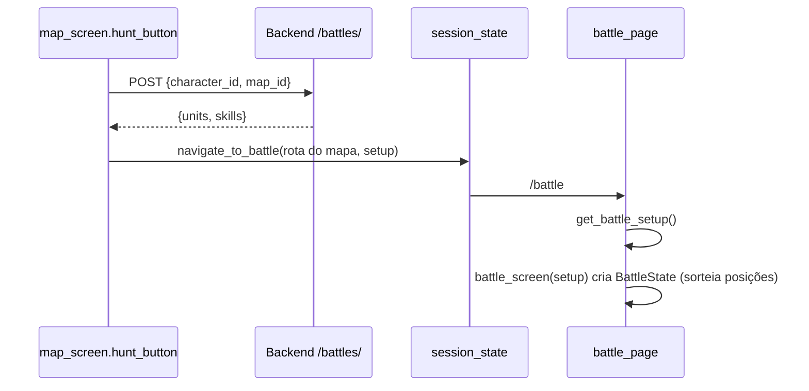

# Sistema de combate

O combate é **por turnos, num tabuleiro isométrico 10×10**. O backend só **monta o encontro** (quem luta e com quais skills); toda a regra do jogo roda no frontend, dentro de `frontend/services/battle_*.py`, e a tela fica em `frontend/pages/battle_page.py`.

## Do botão Hunt até a tela



- `battle_page()` lê `get_battle_setup()`. Sem setup (rota aberta direto), mostra "No battle in progress".
- `battle_screen(setup)` cria o estado com `ft.use_state(lambda: BattleState(...))`. A **lambda** garante que o estado, e o sorteio de posições, só seja criado no primeiro render, e não a cada re-render.

## A unidade (dict)

Cada unidade é um **dict simples**, mutado diretamente. Campos:

| Campo | Origem | Uso |
|---|---|---|
| `name`, `job`, `team` (`"player"`/`"enemy"`) | backend | identidade; `team` define aliados e inimigos |
| `sheet`, `avatar`, `offset_x`, `offset_y` | backend | desenho (sprite sheet, card, ajuste no tile) |
| `hp`, `max_hp`, `ap`, `max_ap` | backend | vida e pontos de ação |
| `skills` | backend | nomes das skills; a primeira é a principal da IA |
| `ai` | backend | comportamento do inimigo (`None` no herói) |
| `col`, `row` | `spawn_units` | posição no tabuleiro |
| `facing` (`se`/`sw`/`nw`/`ne`) | `spawn_units`, ações | direção do sprite |
| `is_draggable` | `spawn_units` | só o jogador pode ser arrastado |
| `anim`, `anim_started` | `battle_animation.play` | clip atual e quando começou |

As unidades ficam em `state.units`, com as chaves `"hero"` e `"monster_1"`. `components/skills_panel.py` lê as skills de `state.units["hero"]`, então a chave `hero` é obrigatória.

## Estado da batalha: `services/battle_state.py`

### Posições iniciais

`spawn_units(units, board)` roda dentro de `BattleState.__init__`:

| Time | Colunas possíveis (`SPAWN_COLUMNS`) | Linha | Direção inicial (`SPAWN_FACING`) |
|---|---|---|---|
| `player` | 0 | aleatória (0–9) | `se` (olhando para os inimigos) |
| `enemy` | 7, 8 ou 9 | aleatória (0–9) | `nw` |

O sorteio usa `random.choice` sobre os tiles livres. Ele evita `board.blocked_tiles` e os tiles já ocupados, então duas unidades nunca nascem no mesmo lugar. `is_draggable` passa a ser `True` só para o time `player`.

### `BattleState`

```python
BattleState(units: dict, skills: dict, board: BoardConfig, turn_duration: int = 30)
```

| Atributo | Significado |
|---|---|
| `units` | cópia profunda (`copy.deepcopy`) das unidades recebidas |
| `skills` | definição das skills (`{nome: {ap_cost, damage, range, icon}}`) |
| `board` | `BoardConfig` |
| `turn_order` | `list(units.keys())`, hoje `["hero", "monster_1"]`: **o herói sempre começa** |
| `turn_index`, `round` | de quem é a vez e a rodada atual (começa em 1) |
| `turn_duration`, `time_left` | limite de 30 s por turno (`TURN_DURATION`) |
| `winner` | `None`, `"victory"` ou `"defeat"` |
| `log` | `BattleLog` |
| `input_locked` | `True` durante o turno do inimigo |
| `closed` | `True` quando a tela sai; para os loops |
| `version` | contador usado para forçar re-render |

Métodos:
- `current_unit_id` / `current_unit()`: de quem é a vez.
- `is_alive(unit_id)`, `unit_at(col, row)` (só unidades vivas).
- `refill_ap(unit_id)`: AP volta ao máximo.
- `end_turn()`: avança para a próxima unidade **viva**; ao dar a volta na lista, incrementa `round`; reinicia o relógio e recarrega o AP de quem vai jogar.
- `tick()`: chamado a cada segundo; desconta `time_left` e, se zerar, chama `end_turn()` e devolve `True`.
- `check_battle_end()`: sem inimigos vivos → `victory`; sem jogador vivo → `defeat`. Registra uma entrada `end` no log.

## Ações: `services/battle_actions.py`

Todas as ações seguem o par **validar → executar** e devolvem um dict `{"ok": bool, "reason": str, ...}`.

### Movimento

`can_move(state, unit_id, col, row) -> (ok, reason, custo)` recusa se:
- a batalha acabou ou não é a vez da unidade;
- o destino é o tile atual, está fora do tabuleiro, bloqueado ou ocupado;
- o custo for maior que o AP disponível.

O **custo é a distância de Manhattan** (`manhattan`): 1 AP por tile. Não há busca de caminho: o custo é a distância em linha "reta" de grade, e unidades no meio do caminho não bloqueiam a passagem, só o destino.

`perform_move` vira a unidade para o destino (`face_towards`), atualiza `col`/`row`, desconta o AP e registra um `LogEntry(kind="move")`.

### Ataque

`can_attack(state, attacker_id, target_id, skill_name)` exige:
- batalha em andamento e vez do atacante;
- a skill existir em `state.skills` **e** estar na lista `skills` do atacante;
- alvo vivo e do outro time;
- AP suficiente (`ap_cost`);
- alvo **em linha reta**, na mesma linha ou coluna, a uma distância entre 1 e `range` (`in_range`). Diagonais não contam.

`perform_attack`:
1. Desconta `ap_cost` e aplica `damage` (fixo, sem defesa ou variação; o HP não fica negativo).
2. Vira o atacante para o alvo e toca `attack`. O alvo toca `hurt`, ou `dead` se o HP zerar.
3. Se o alvo morreu, registra `LogEntry(kind="defeat")` e chama `state.check_battle_end()`.

> O ataque em si **não é registrado no log**. `LogEntry` já sabe formatar `kind="attack"` (com o dano em vermelho), mas `perform_attack` não adiciona essa entrada.

`get_attack_tiles(state, unit_id, skill_name)` devolve os tiles que a skill alcança nas 4 direções, usados para destacá-los no tabuleiro.

## IA dos inimigos: `services/battle_ai.py`

`iter_ai_turn(state, unit_id)` escolhe o comportamento em `BEHAVIORS` pelo campo `unit["ai"]` (padrão `passive`). Cada comportamento é um **gerador**: dá `yield` depois de cada ação para a página redesenhar e esperar entre os passos.

| Nome | Função | Comportamento |
|---|---|---|
| `passive` | `passive` | não faz nada |
| `attack_every_turn` | `attack_every_turn` | não se move; ataca o inimigo mais próximo enquanto conseguir (AP, alcance) |
| `approach_and_attack` | `approach_and_attack` | se não alcança o alvo, anda até o melhor tile e então ataca enquanto der. **É o do Poring.** |

Funções auxiliares:
- `_main_skill(unit)`: `unit["skills"][0]`.
- `_nearest_enemy_id`: inimigo vivo mais próximo pela distância de Manhattan.
- `_best_approach_tile`: testa todos os tiles válidos e escolhe pela ordem de prioridade (1) poder atacar dali com o AP que sobra, (2) menor distância ao alvo, (3) menor custo. Se nenhum tile melhora a situação, fica parado.

`run_ai_turn` executa o gerador inteiro sem pausas (útil em testes).

## Tela de batalha: `pages/battle_page.py`

### Loops

Ao montar, `battle_screen` inicia duas tarefas assíncronas:

- **`turn_loop`**
  - Turno do **inimigo**: trava a entrada (`input_locked = True`), espera `ENEMY_ACTION_DELAY` (0,7 s), percorre `iter_ai_turn` com uma pausa após cada ação, chama `end_turn()` e destrava.
  - Turno do **jogador**: acorda a cada `TICK_INTERVAL` (0,25 s) e chama `state.tick()` a cada 1 s acumulado. Se o tempo acabar, o turno passa sozinho e a skill selecionada é limpa.
  - Para quando a batalha acaba ou a tela fecha.
- **`anim_loop`**: re-renderiza a ~12 fps (`ANIM_INTERVAL = 1/12`) para as animações andarem. Ele **não para quando há vencedor**, para que o clip `dead` termine de tocar; só para com `state.closed`.

`on_unmount` e o botão **Leave** marcam `state.closed = True`.

`refresh(clear_skill=False)` deve ser chamado depois de **qualquer** mudança no estado: incrementa `state.version` e atualiza um `use_state`, o que força o re-render.

### Interação do jogador

| Ação | Onde | Como |
|---|---|---|
| Mover | `components/battle_board.py` | arrastar o próprio sprite (`on_pan_*`). Durante o arraste, o tile de destino fica verde (`VALID_TILE_COLOR`) se `can_move` aceitar, vermelho se não. Ao soltar, `perform_move`. |
| Escolher skill | `components/skills_panel.py` → `handle_select_skill` | clique no ícone; clicar de novo desmarca. Só funciona na vez do jogador e com AP suficiente. |
| Atacar | `battle_board.handle_tap` | com uma skill selecionada, os tiles de alcance ficam destacados (`ATTACK_TILE_COLOR`); clicar no sprite de um inimigo chama `perform_attack`. |
| Passar a vez | `components/turn_panel.py` → `handle_end_turn` | botão **Turn End** |
| Sair | `turn_panel` → `handle_leave` | botão **Leave**, sempre habilitado; volta para o mapa com `navigate_back_from_battle()` |

O estado do arraste fica num dict global do módulo, `_drag_state`, em `battle_board.py`.

### Layout

```
┌ sidebar ┬─────────────────────────────────────────────────────────┐
│         │ units_panel (330)  │ battle_board (1100 × 700)          │
│         │────────────────────┼──────────────────┬─────────────────│
│         │ skills_panel (330) │ battle_log_panel │ turn_panel (300)│
└─────────┴─────────────────────────────────────────────────────────┘
```

- `units_panel` (`components/unit_card.py`): um card por unidade, na ordem dos turnos, com avatar, nome, job, HP e AP (rótulo "PA"). A unidade da vez tem borda dourada; mortas ficam com 40% de opacidade.
- `battle_log_panel` (`components/battle_log_panel.py`): mostra `state.log.entries` com rolagem automática.
- `turn_panel`: rodada, tempo restante, "Enemy turn...", "Victory!" ou "Defeat...", e os botões.
- `CONTENT_WIDTH = LEFT_WIDTH + GAP + BOARD_WIDTH` (1446 px) também limita a largura das telas de mapa.

### Desenho do tabuleiro (`components/battle_board.py`)

Três camadas num `ft.Stack`, dentro de um `ft.GestureDetector`:

1. **Fundo**: `board.background_image` (`battle_boards/forest_battlefield.jpg`) ou uma cor de reserva.
2. **Grade**: `cv.Canvas` com `STATIC_GRID_SHAPES` (contornos montados uma vez na importação, em `components/battle_grid.py`) mais os destaques do momento.
3. **Sprites**: unidades ordenadas por profundidade (`sort_units_by_depth`). Unidades mortas continuam desenhadas para mostrar o último frame de `dead`. A unidade arrastada é desenhada por cima de todas.

> Existe um ramo para unidades **sem** sprite sheet que usa os campos `sprite`, `width`, `height` e `placeholder_color`. O backend não envia esses campos; o ramo sobrou da época do mockup e só não quebra porque toda unidade enviada hoje tem `sheet`.

## Geometria: `services/battle_geometry.py`

`BoardConfig`: palco fixo de 1100×700, grade 10×10, tiles de 96×48 (losango 2:1), origem do tile (0,0) em (540, 200), `blocked_tiles` vazio, `show_grid=True`.

| Função | Faz |
|---|---|
| `tile_to_pixel(col, row, board)` | centro do tile em pixels. +1 col anda para baixo-direita; +1 row anda para baixo-esquerda |
| `pixel_to_tile(x, y, board)` | inversa, com `round()`; é o que dá o "encaixe" ao soltar o sprite |
| `is_inside_board` | limites da grade |
| `get_depth(unit)` | `col + row`; maior = mais perto da câmera |
| `sort_units_by_depth(units, farthest_first)` | ordem de pintura (`True`) ou de clique (`False`) |
| `get_sprite_bounds(unit, cx, cy)` | caixa do sprite com os **pés** (anchor da sheet) no centro do tile, mais `offset_x/offset_y` |

Direções no tabuleiro: +col = SE, -col = NW, +row = SW, -row = NE (`battle_animation.face_towards`).

## Log: `services/battle_log.py`

`LogEntry` (dataclass) tem `round`, `kind` (`move`, `attack`, `defeat`, `end`) e os campos opcionais `actor`, `target`, `skill`, `damage`, `tiles`, `dest` e `result`. A propriedade `message` gera o texto, e `damage_text` gera o "-N damage". `BattleLog` é só uma lista com `add()` e `print_all()`.

## Fim da batalha

- **Vitória**: todos os inimigos com HP 0. **Derrota**: o herói com HP 0.
- O painel de turno mostra o resultado; não é possível agir, só sair com **Leave**.
- **Nada é persistido**: o HP do personagem não muda, não há EXP, zeny nem drops, e sair no meio da luta não tem penalidade.
